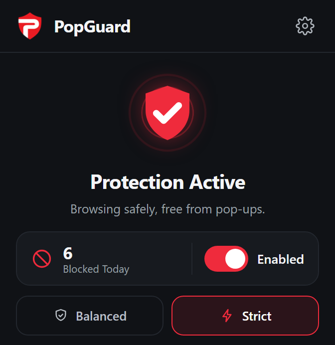
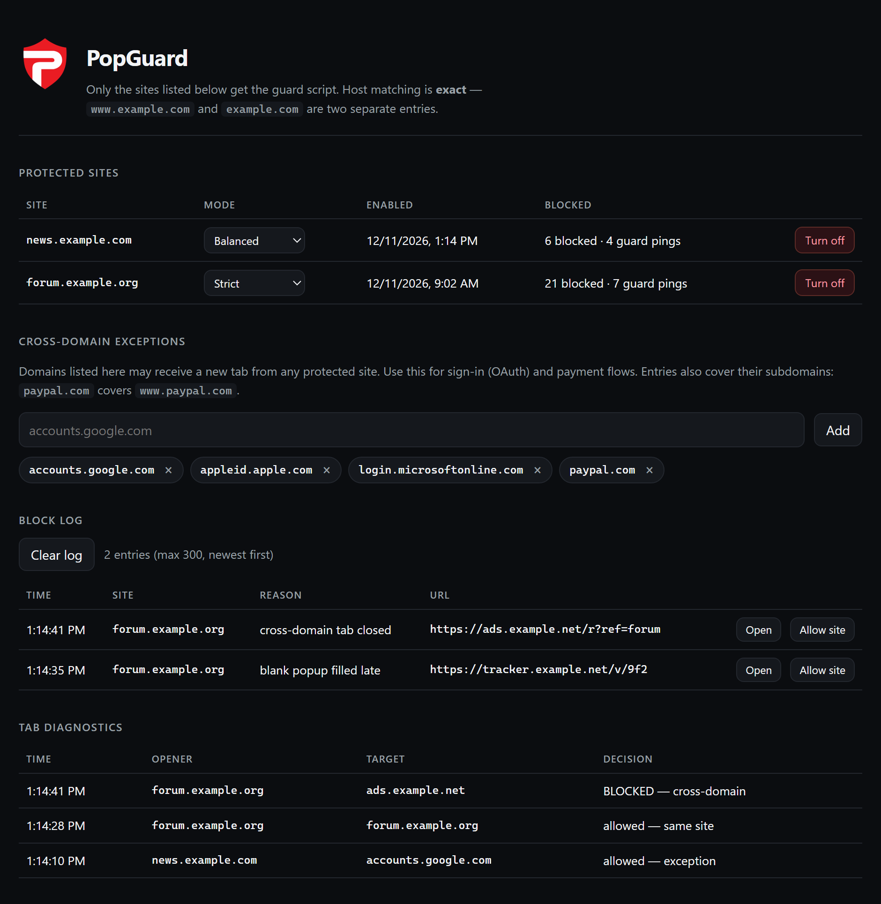

<p align="center">
  
</p>

<h1 align="center">PopGuard</h1>

<p align="center">
  <strong>Blocks unwanted pop-ups, cross-domain pop-ups and stray tabs — only on the sites you enable.</strong>
</p>

PopGuard is a small Manifest V3 extension for Brave, Chrome and other Chromium
browsers. Instead of trying to judge every site, it hides behind a simple rule:
**you arm a site, and that site gets protected**. Each armed host runs in one of
two modes — balanced for forums where links are meant to leave the page, strict
for ad-heavy pages where nothing should open on its own.

No build step, no dependencies, no network calls, no telemetry.

## Why this exists

Some sites deserve your ad blocker switched off. But turning it off often brings
pop-ups and forced new tabs that make the site unusable — so goodwill turns into
a reason to leave.

PopGuard does not filter ads, trackers or network requests, and it is not a
replacement for an ad blocker. It only stops tabs you did not ask for, so you can
support a site and still keep the tab bar under control.

## Screenshots

<p align="center">
  
</p>

<p align="center"><em>The popup — shield state, blocked-today count, per-site toggle and mode.</em></p>

<p align="center">
  
</p>

<p align="center"><em>Settings — protected sites, exceptions, block log and tab diagnostics.</em></p>

<p align="center"><sub>Sample data shown. Hostnames and log entries are illustrative.</sub></p>

## Features

- **Per-site protection.** Only hosts you turn on get the guard script.
- **Two layers.** A page-level guard that stops pop-ups before they open, and a
  browser-level watchdog that closes what slips past it.
- **Two modes.**
  - **Balanced** — real clicks may leave the site; tabs with no interaction,
    pop-ups without an opener and blank tabs filled by ads are still blocked.
  - **Strict** — every cross-domain tab is blocked unless the domain is
    explicitly excepted. Right-click, Ctrl-click and middle-click still work.
- **Block log and diagnostics.** Every decision is recorded with its reason, so
  a false positive can be traced instead of guessed.
- **No build step, no dependencies, no network calls.**

## Install (unpacked)

1. Clone or download this repository.
2. Open `brave://extensions` or `chrome://extensions`.
3. Enable **Developer mode**.
4. Click **Load unpacked** and select the repository root — the folder that
   contains `manifest.json`, not a subfolder.
5. Open any site, click the PopGuard icon, flip **Enabled**.

Reload the page after enabling: the guard is only installed on page load.

## How it works

```
page guard   src/page/guard.js      MAIN world, document_start
             patches window.open, guards invisible _blank anchors, blocks
             cross-domain pop-ups (strict mode)

bridge       src/content/bridge.js  ISOLATED world
             relays messages, fetches config, reports liveness

watchdog     src/background/sw.js   service worker
             closes cross-domain tabs, handles blank pop-ups, keeps the log
```

The page guard cannot be the only defence: it is subject to the page's CSP,
does not exist inside cross-origin ad iframes, and can be undone by a page that
restores its own `window.open`. The service worker watchdog does not care about
any of that, so it is the layer that always runs.

Settings live in `chrome.storage.sync` (protected hosts, exceptions) and
`chrome.storage.local` (block log, diagnostics).

## Permissions

| Permission | Why |
| --- | --- |
| `host_permissions: *://*/*` | The guard must be installable on whichever site you enable. Granting it once at install avoids a per-site prompt. Scripts are still only registered for hosts you arm. |
| `scripting` | To register and remove the per-host content scripts. |
| `tabs` | To read the URL of new tabs so the watchdog can decide whether to close them. |
| `storage` | To keep the host list, log and diagnostics. |

Nothing is sent to any server. There is no analytics, no remote code and no
telemetry. See [PRIVACY.md](PRIVACY.md).

## Development

No bundler, no `node_modules`. Edit files and reload the extension.

```powershell
# syntax check (there is no test runner; the browser is the verifier)
node --check src/background/sw.js
node --check src/page/guard.js
node --check src/content/bridge.js
node --check src/ui/popup.js
node --check src/ui/options.js

# manual fixtures on http://localhost:8123/
powershell -ExecutionPolicy Bypass -File test/serve.ps1
```

`test/fixtures/` contains six pages, one per behaviour, plus a control case that
must stay allowed. Open fixtures over `http://localhost`, not `file://` — the
extension has no file access by default and the guard will not load.

Release packaging:

```powershell
powershell -ExecutionPolicy Bypass -File release.ps1
```

## Known limitations

- **A tab opened without an opener** (noopener) is attributed by focus; a
  background tab in the same window is deliberately left alone.
- **Pop-ups that never leave `about:blank`** (content written via
  `document.write`) are not closed, because closing all blank tabs would break
  typing a URL into a new tab.
- **Pop-ups opened by a plain left click** are allowed in balanced mode and
  blocked in strict mode. That is the line between a forum and an ad-heavy site.
- **Redirect surveillance** only runs in strict mode and only for tabs the user
  did not open personally.
- Practically tested on Brave; other Chromium browsers should work but are not
  covered by a test suite.

## License

MIT — see [LICENSE](LICENSE).
