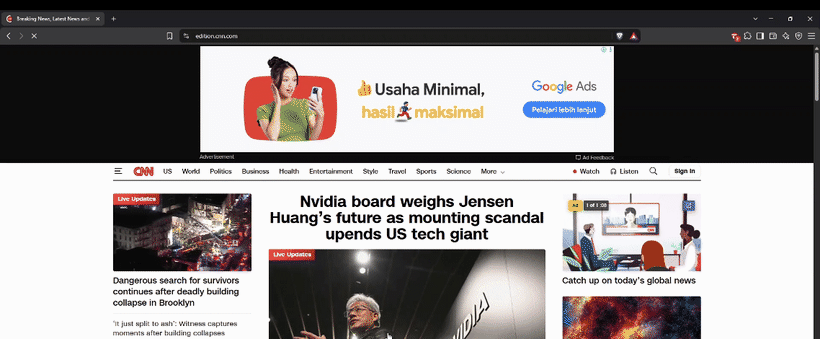
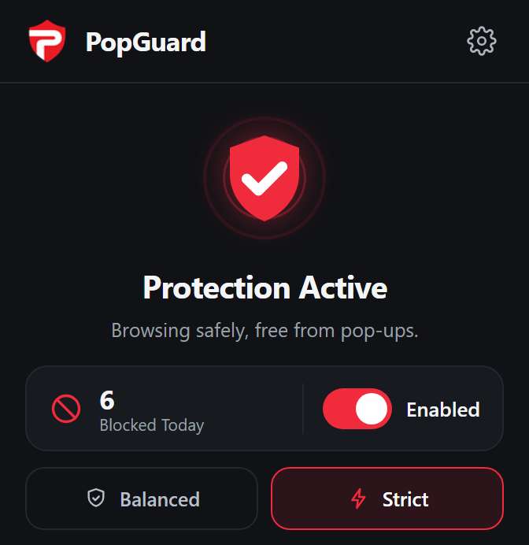
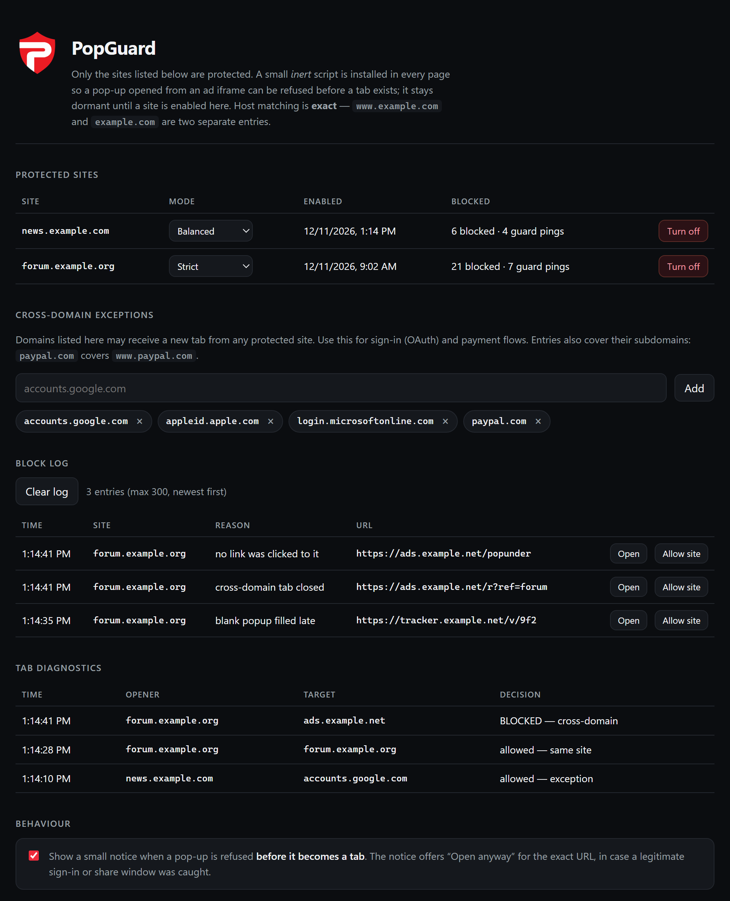

  

<h1 align="center">PopGuard</h1>

  <strong>Blocks unwanted pop-ups, cross-domain pop-ups and stray tabs — only on the sites you enable.</strong>

PopGuard is a small Manifest V3 extension for Brave, Chrome and other Chromium
browsers. Instead of trying to judge every site, it hides behind a simple rule:
**you arm a site, and that site gets protected**. Each armed host runs in one of
two modes — balanced for forums where links are meant to leave the page, strict
for ad-heavy pages where nothing should open on its own.

No build step, no dependencies, no network calls, no telemetry.

## Why this exists

Some sites deserve your ad blocker switched off. But turning it off often brings
pop-ups and forced new tabs that make the site unusable — so goodwill turns into
a reason to leave.

PopGuard does not filter ads, trackers or network requests, and it is not a
replacement for an ad blocker. It only stops tabs you did not ask for, so you can
support a site and still keep the tab bar under control.

## Demo

  

<em>Clicking an ad banner on a news site — the new tab is created and closed before it renders.</em>

## Screenshots

  

<em>The popup — shield state, blocked-today count, per-site toggle and mode.</em>

  

<em>Settings — protected sites, exceptions, block log and tab diagnostics.</em>

Sample data shown. Hostnames and log entries are illustrative.

## Features

- **Per-site protection.** Only hosts you turn on are protected. A small inert
  frame script is installed in every page so a pop-up fired from an ad iframe can
  be refused; it does nothing until a site is enabled.
- **No tab at all.** A pop-up that leaves the site without a clicked link
  pointing at it is refused inside `window.open` — and so is a blank
  `about:blank` pop-up, which was the last way an ad tab still appeared — so no
  tab is created and nothing flashes. A small notice offers **Open anyway** for
  that exact URL.
- **Two layers.** A page-level guard that stops pop-ups before they open, and a
  browser-level watchdog that handles what only exists after a tab is born —
  a same-site banner that redirects to an ad.
- **Two modes.**
  - **Balanced** — real clicks on links may leave the site; pop-ups fired by a
    script still need evidence, and tabs with no interaction, pop-ups without an
    opener and blank tabs filled by ads are blocked.
  - **Strict** — every cross-domain tab is blocked unless the domain is
    explicitly excepted. Right-click, Ctrl-click and middle-click still work.
- **Block log and diagnostics.** Every decision is recorded with its reason, so
  a false positive can be traced instead of guessed.
- **No build step, no dependencies, no network calls.**

## Install (unpacked)

1. Clone or download this repository.
2. Open `brave://extensions` or `chrome://extensions`.
3. Enable **Developer mode**.
4. Click **Load unpacked** and select the repository root — the folder that
   contains `manifest.json`, not a subfolder.
5. Open any site, click the PopGuard icon, flip **Enabled**.

Reload the page after enabling: the guard is only installed on page load.

## Known limitations

- **A tab opened without an opener** (noopener) is attributed by focus; a
  background tab in the same window is deliberately left alone.
- **A same-site banner that redirects** cannot be refused at birth — at that
  moment it is indistinguishable from a legitimate same-site pop-up. It is
  closed by the watchdog before the ad page loads (strict mode only).
- **Pop-ups that only ever exist as `about:blank`** (content written via
  `document.write`) are refused altogether. Legacy print/preview windows that use
  that pattern stop working on an enabled site; in exchange, an ad can no longer
  open a blank tab and fill it a second later.
- **Pop-ups opened by a plain left click on a cross-domain link** are allowed in
  balanced mode and blocked in strict mode. That is the line between a forum and
  an ad-heavy site.
- Practically tested on Brave; other Chromium browsers should work but are not
  covered by a test suite.

## License

MIT — see [LICENSE](LICENSE).
